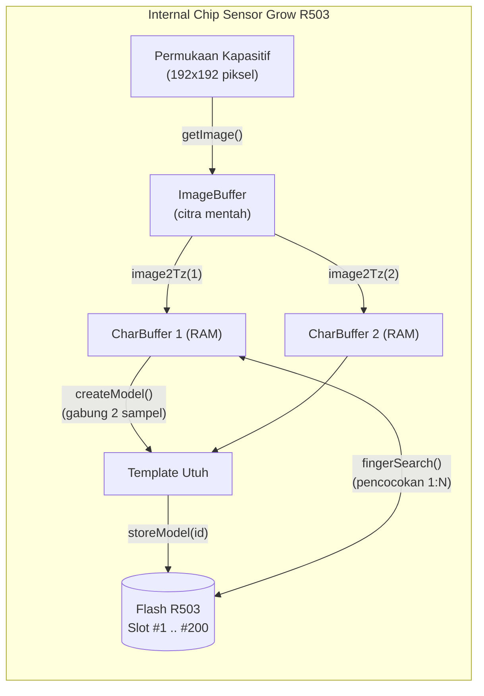
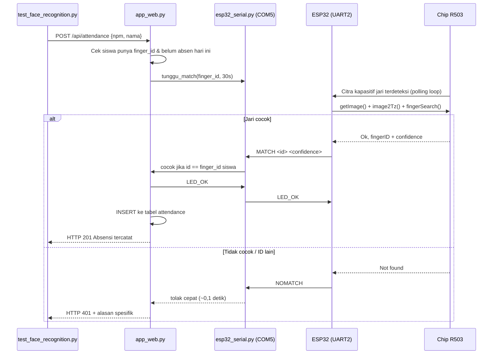

# Cara Kerja Sensor Sidik Jari R503 & Firmware ESP32 (`esp32R503-Serial.ino`)

Dokumen ini menjelaskan **prinsip fisik sensor kapasitif Grow R503**, **arsitektur memori internalnya**, **wiring ke ESP32**, **protokol teks USB ke laptop**, dan **bedah kode firmware** `firmware/esp32R503-Serial/esp32R503-Serial.ino` baris per baris.

---

## 1. Prinsip Kerja Fisik Sensor Grow R503

Berbeda dengan sensor optik lama (kamera + lampu hijau), **R503 adalah sensor kapasitif semikonduktor** (seperti sensor sidik jari di smartphone) yang memiliki **prosesor DSP + memori Flash sendiri di dalam modulnya**. ESP32 hanya mengirim perintah dan menerima hasil, tanpa melakukan perhitungan biometrik.

### A. Akuisisi Citra Kapasitif
1. Permukaan bulat R503 berisi array **pelat kapasitor mikroskopis (192 × 192 piksel, 508 DPI)**.
2. Saat jari menempel:
   * **Punggungan (*ridge*)** menyentuh permukaan → jarak pelat sangat dekat → **kapasitansi tinggi**.
   * **Lembah (*valley*)** menyisakan celah udara → **kapasitansi rendah**.
3. Perbedaan muatan ini dibaca per piksel dan diubah menjadi citra *grayscale* 2D di memori sementara (**`ImageBuffer`**).

### B. Ekstraksi Titik Minutiae
R503 **tidak menyimpan gambar mentah sidik jari** (tidak bisa "dibalik" menjadi foto). Prosesor DSP internal mencari:
* *Ridge ending* (ujung guratan)
* *Bifurcation* (percabangan guratan)
* Jarak, arah, dan sudut antar titik

Hasilnya berupa **vektor fitur kompak (*character file*)** yang jauh lebih kecil dari citra asli. Proses ini di library Adafruit dinamakan `image2Tz()` (*image to template*).

### C. Arsitektur Memori Internal R503

| Memori | Sifat | Dipakai oleh |
| :--- | :--- | :--- |
| `ImageBuffer` | RAM, hilang saat mati | `getImage()` |
| `CharBuffer1` (slot 1) | RAM, hilang saat mati | `image2Tz(1)`, `verifikasi()` |
| `CharBuffer2` (slot 2) | RAM, hilang saat mati | `image2Tz(2)` |
| Flash `#1 .. #200` | **Permanen**, tidak hilang saat listrik mati | `storeModel(id)`, `deleteModel(id)`, `fingerSearch()` |

Nomor slot Flash `#1..#200` inilah yang disimpan ke kolom `finger_id` pada tabel `students` di SQLite. Jadi database SQLite menyimpan **peta NPM → nomor slot**, sedangkan data sidik jarinya sendiri tetap berada di dalam chip R503.



### D. Dua Mode Pencocokan

| Mode | Fungsi Library | Kapan Dipakai di Proyek |
| :--- | :--- | :--- |
| **1:N (Search)** | `fingerSearch()` | Saat absensi. Jari siapa pun ditempel → sensor mencari di **seluruh** slot, menghasilkan `MATCH <id> <confidence>` atau `NOMATCH`. |
| **1:1 (Verify)** | `fingerVerify()` | Tidak dipakai (2FA di proyek ini memakai 1:N lalu Flask membandingkan `id` hasil sensor dengan `finger_id` siswa yang wajahnya dikenali). |

---

## 2. Wiring R503 ke ESP32

| Kabel R503 | Warna | Fungsi | Pin ESP32 |
| :--- | :--- | :--- | :--- |
| VCC | **Merah** | Catu daya sensor + LED ring | `3V3` (**wajib 3.3 V**, jangan 5 V) |
| GND | **Hitam** | Ground | `GND` |
| TX | **Kuning** | Data keluar dari R503 | `GPIO 16` (`RX2`) |
| RX | **Hijau** | Data masuk ke R503 | `GPIO 17` (`TX2`) |
| WAKE | **Biru** | Sinyal sentuh / wakeup | `GPIO 4` (opsional, dibaca tapi tidak wajib) |
| 3.3VT | **Putih** | Catu rangkaian sentuh | `3V3` |

Catatan: **TX sensor harus masuk ke RX ESP32** dan sebaliknya. Kesalahan silang TX-TX adalah penyebab paling umum `SENSOR_FAIL 0`.

### Kenapa ESP32 Memakai 2 Kanal Serial?

| Kanal | Baudrate | Lawan Bicara | Isi Data |
| :--- | :--- | :--- | :--- |
| `Serial` (UART0, kabel USB) | 115200 | Laptop (`esp32_serial.py` / Flask / Serial Monitor) | **Teks baris**: `PING`, `ENROLL 3`, `MATCH 3 95`, `NOMATCH` |
| `fpSerial` (UART2, GPIO16/17) | 57600 | Chip R503 | **Paket biner heksadesimal** protokol R503 |

UART2 dipakai agar perintah dari laptop tidak bertabrakan dengan lalu lintas data sensor.

---

## 3. Protokol Teks USB (ESP32 ↔ Laptop)

Semua pesan adalah **satu baris teks diakhiri `\n`**, dibaca oleh `esp32_serial.py` di sisi Python.

### Perintah dari Laptop ke ESP32

| Perintah | Efek | Balasan |
| :--- | :--- | :--- |
| `PING` (atau `m`) | Baca jumlah template | `PONG <jumlah_template>` |
| `ENROLL <id>` | Rekam sidik jari ke slot `id` (`1..200`) | `PLACE <id>` → `REMOVE` → `PLACE <id>` → `ENROLL_OK <id> 0` / `ENROLL_FAIL <id> <kode>` |
| `DELETE <id>` (atau `d <id>`) | Hapus 1 slot | `DELETE_OK <id> 0` / `DELETE_FAIL <id> <kode>` |
| `CLEAR` (atau `c`) | Hapus seluruh Flash R503 | `CLEAR_OK 0` / `CLEAR_FAIL <kode>` |
| `LED_OK` | Kedip indikator sukses absensi | `LED_DONE` |
| `e` | Mode enroll interaktif Serial Monitor | `Masukkan ID (1-200):` lalu proses enroll |

### Event dari ESP32 ke Laptop

| Event | Arti |
| :--- | :--- |
| `BOOT 1.0` | ESP32 baru menyala / reset |
| `READY <jumlah>` | Sensor lolos handshake password, siap dipakai |
| `SENSOR_FAIL 0` | Sensor tidak menjawab (kabel lepas / salah TX-RX / catu daya kurang) |
| `PLACE <id>` / `REMOVE` | Instruksi tempel / angkat jari saat enroll |
| `MATCH <id> <confidence>` | Jari cocok dengan slot `<id>` |
| `NOMATCH` | Jari tidak dikenali |
| `ERR_UNKNOWN <perintah>` | Perintah tidak dikenal |

---

## 4. Bedah Kode `esp32R503-Serial.ino`

### 4.1 Header, Pin, dan Objek Global (baris 23–36)

```cpp
#include <Adafruit_Fingerprint.h>

#define FW_VERSION "1.0"
#define RX_PIN      16   // GPIO16 (RX2 ESP32) <- kabel Kuning (TX R503)
#define TX_PIN      17   // GPIO17 (TX2 ESP32) -> kabel Hijau (RX R503)
#define WAKEUP_PIN   4   // GPIO4 <- kabel Biru R503 (opsional)

HardwareSerial fpSerial(2);
Adafruit_Fingerprint finger(&fpSerial);
```

* `HardwareSerial fpSerial(2)`: Mengaktifkan **UART2** ESP32 khusus untuk sensor, sehingga `Serial` (USB) tetap bebas untuk komunikasi dengan Flask.
* `Adafruit_Fingerprint finger(&fpSerial)`: Mengikat library sensor ke jalur `fpSerial`. Semua metode seperti `getImage()`, `image2Tz()`, `fingerSearch()` dikirim lewat kanal ini.

### 4.2 Kontrol Cincin LED RGB (baris 38–44)

```cpp
void ledBiru()   { finger.LEDcontrol(FINGERPRINT_LED_BREATHING, 100, FINGERPRINT_LED_BLUE); }
void ledHijau()  { finger.LEDcontrol(FINGERPRINT_LED_ON, 0, FINGERPRINT_LED_PURPLE); }
void ledMerah()  { finger.LEDcontrol(FINGERPRINT_LED_FLASHING, 25, FINGERPRINT_LED_RED, 3); }
void ledMati()   { finger.LEDcontrol(FINGERPRINT_LED_OFF, 0, FINGERPRINT_LED_BLUE); }
```

Format: `LEDcontrol(mode, speed, color, count)`.

| Fungsi | Efek Visual | Makna |
| :--- | :--- | :--- |
| `ledBiru()` | Biru bernapas | Sensor siaga / menunggu jari |
| `ledHijau()` | Nyala penuh | Rekam / verifikasi berhasil |
| `ledMerah()` | Merah berkedip 3× | Jari ditolak / gagal rekam |
| `ledMati()` | Mati | Kembali ke kondisi diam |

Catatan teknis: fungsi bernama `ledHijau()` sebenarnya memakai konstanta `FINGERPRINT_LED_PURPLE` (warna ungu). Ini warisan kode awal dan hanya berpengaruh pada **warna tampilan**, bukan logika verifikasi.

### 4.3 Pengiriman Pesan ke Laptop (baris 48–58)

```cpp
void kirim(const String &baris) {
  Serial.println(baris);
  Serial.flush();
}

void kirimKode(const char *perintah, uint8_t id, uint8_t kode) {
  char buffer[48];
  snprintf(buffer, sizeof(buffer), "%s %u %u", perintah, id, kode);
  kirim(buffer);
}
```

* `Serial.println()` menambahkan `\n` yang menjadi penanda akhir baris bagi `esp32_serial.py`.
* `Serial.flush()` menahan eksekusi sampai seluruh byte benar-benar keluar dari buffer UART0, sehingga pesan status tidak "tertahan" saat ESP32 langsung masuk ke operasi sensor yang memakan waktu.
* `kirimKode()` menstandarkan format `<STATUS> <id> <kode_error>`, misalnya `ENROLL_OK 3 0` atau `ENROLL_FAIL 3 254`.

### 4.4 Menunggu Jari & Debounce (baris 62–80)

```cpp
uint8_t tungguJari(uint32_t timeout_ms = 15000) {
  uint32_t mulai = millis();
  while (millis() - mulai < timeout_ms) {
    uint8_t p = finger.getImage();
    if (p == FINGERPRINT_OK) return FINGERPRINT_OK;
    if (p == FINGERPRINT_NOFINGER) { delay(50); continue; }
    return p;
  }
  return FINGERPRINT_TIMEOUT;
}

void tungguJariAngkat(uint32_t timeout_ms = 4000) {
  uint32_t mulai = millis();
  while (millis() - mulai < timeout_ms) {
    if (finger.getImage() == FINGERPRINT_NOFINGER) return;
    delay(50);
  }
}
```

* `tungguJari()`: polling `getImage()` tiap 50 ms sampai jari menempel, atau mengembalikan `FINGERPRINT_TIMEOUT` setelah 15 detik. Dipakai hanya saat **enroll** (karena memang harus menunggu manusia menempelkan jari). Kode error lain (mis. gambar buram) langsung dikembalikan apa adanya agar bisa dilaporkan ke Flask.
* `tungguJariAngkat()`: menahan sampai permukaan sensor kosong. Tanpa fungsi ini, satu tempelan jari bisa memicu `MATCH` berkali-kali dalam beberapa ratus milidetik.

### 4.5 Enroll Sidik Jari — `enrollFinger(id)` (baris 88–124)

```cpp
void enrollFinger(uint8_t id) {
  kirim(String("PLACE ") + id);
  ledBiru();

  uint8_t p = tungguJari();
  if (p != FINGERPRINT_OK) { kirimKode("ENROLL_FAIL", id, p); ledMerah(); return; }

  p = finger.image2Tz(1);
  if (p != FINGERPRINT_OK) { kirimKode("ENROLL_FAIL", id, p); ledMerah(); return; }

  kirim("REMOVE");
  tungguJariAngkat();

  kirim(String("PLACE ") + id);
  p = tungguJari();
  if (p != FINGERPRINT_OK) { kirimKode("ENROLL_FAIL", id, p); ledMerah(); return; }

  p = finger.image2Tz(2);
  if (p != FINGERPRINT_OK) { kirimKode("ENROLL_FAIL", id, p); ledMerah(); return; }

  p = finger.createModel();
  if (p != FINGERPRINT_OK) { kirimKode("ENROLL_FAIL", id, p); ledMerah(); return; }

  p = finger.storeModel(id);
  if (p != FINGERPRINT_OK) { kirimKode("ENROLL_FAIL", id, p); ledMerah(); return; }

  kirimKode("ENROLL_OK", id, 0);
  ledHijau();
  delay(600);
  ledMati();
}
```

Urutan 4 tahap:

1. **Sampel pertama** → `getImage()` lalu `image2Tz(1)` menyimpan fitur ke `CharBuffer1`.
2. **Angkat jari** → `REMOVE` + `tungguJariAngkat()` memastikan sampel kedua berasal dari tempelan baru, bukan sisa gambar lama.
3. **Sampel kedua** → `image2Tz(2)` menyimpan fitur ke `CharBuffer2`.
4. **Gabung & simpan** → `createModel()` membandingkan dua sampel; jika berasal dari jari berbeda ia gagal (`FINGERPRINT_ENROLLMISMATCH`). `storeModel(id)` menulis template ke Flash slot `id`.

Setiap kegagalan mengirim `ENROLL_FAIL <id> <kode>` sehingga Flask bisa membatalkan pendaftaran, menghapus folder foto yang baru dibuat, dan menampilkan penyebabnya di browser.

### 4.6 Verifikasi 1:N — `verifikasi()` (baris 128–155)

```cpp
void verifikasi() {
  uint8_t p = finger.getImage();
  if (p != FINGERPRINT_OK) return;

  p = finger.image2Tz();
  if (p != FINGERPRINT_OK) return;

  p = finger.fingerSearch();
  if (p == FINGERPRINT_OK) {
    char buffer[48];
    snprintf(buffer, sizeof(buffer), "MATCH %u %u", finger.fingerID, finger.confidence);
    kirim(buffer);
    ledHijau();
    delay(400);
    ledMati();
  } else {
    kirim("NOMATCH");
    ledMerah();
    delay(300);
    ledMati();
  }

  tungguJariAngkat();
  delay(300);
}
```

* **Non-blocking**: bila tidak ada jari, fungsi langsung kembali sehingga `loop()` tetap bisa memproses perintah `ENROLL` / `PING` dari laptop.
* `fingerSearch()` menjalankan pencocokan **di dalam chip R503** (bukan di ESP32), sehingga hasilnya cepat dan hemat daya.
* `MATCH <id> <confidence>`: `fingerID` = nomor slot, `confidence` = skor kemiripan. Flask lalu membandingkan `id` tersebut dengan `finger_id` milik siswa yang wajahnya sedang dikenali kamera. Jika berbeda, absensi ditolak dengan pesan "jari cocok dengan template ID lain".
* `NOMATCH` dikirim eksplisit supaya `esp32_serial.py` **langsung menolak dalam ~0,1 detik**, bukan menggantung menunggu batas 30 detik.
* `tungguJariAngkat()` + `delay(300)` mencegah satu tempelan menghasilkan dua event berurutan.

### 4.7 Parser Perintah — `prosesPerintah()` (baris 158–222)

```cpp
void prosesPerintah(String baris) {
  baris.trim();
  if (baris.length() == 0) return;

  if (baris == "PING" || baris == "m") {
    finger.getTemplateCount();
    kirim(String("PONG ") + finger.templateCount);
    return;
  }
  ...
  int spasi = baris.indexOf(' ');
  String perintah = (spasi < 0) ? baris : baris.substring(0, spasi);
  int id = (spasi < 0) ? -1 : baris.substring(spasi + 1).toInt();
  ...
}
```

* `trim()` membuang `\r` (Windows) dan spasi agar `ENROLL 3\r\n` tetap terbaca.
* Perintah tanpa argumen (`PING`, `LED_OK`, `CLEAR`) dibandingkan langsung dengan `==`.
* Perintah berargumen dipecah pada spasi pertama: `"ENROLL 3"` → `perintah = "ENROLL"`, `id = 3`.
* `id` divalidasi `1..200` (kapasitas Flash R503). Nilai di luar itu dibalas `ENROLL_FAIL 0 255` / `DELETE_FAIL 0 255`.
* Singkatan `m`, `c`, `d`, `e` disediakan untuk pengujian manual lewat Serial Monitor Arduino IDE.

### 4.8 `setup()` — Inisialisasi (baris 225–246)

```cpp
void setup() {
  Serial.begin(115200);
  pinMode(WAKEUP_PIN, INPUT);
  fpSerial.begin(57600, SERIAL_8N1, RX_PIN, TX_PIN);

  delay(300);
  kirim(String("BOOT ") + FW_VERSION);

  finger.begin(57600);
  delay(100);

  if (!finger.verifyPassword()) {
    kirim("SENSOR_FAIL 0");
    return;
  }

  finger.getTemplateCount();
  kirim(String("READY ") + finger.templateCount);
  ledBiru();
}
```

* `Serial.begin(115200)`: kanal USB ke laptop.
* `fpSerial.begin(57600, SERIAL_8N1, RX_PIN, TX_PIN)`: kanal UART2 ke R503 (baudrate bawaan R503 = **57600**, 8 data bit, tanpa parity, 1 stop bit).
* `delay(300)`: memberi waktu regulasi tegangan sensor setelah power-on.
* `finger.verifyPassword()`: handshake awal protokol R503. Bila gagal → `SENSOR_FAIL 0`. Firmware **tidak** memakai `while(1)` di sini supaya ESP32 tidak hang dan Flask tetap bisa menampilkan status "sensor tidak terdeteksi" di halaman pendaftaran.
* Bila berhasil: `READY <jumlah_template>` + LED biru bernapas.

### 4.9 `loop()` — Siklus Utama (baris 249–261)

```cpp
void loop() {
  if (Serial.available()) {
    String baris = Serial.readStringUntil('\n');
    prosesPerintah(baris);
    return;
  }

  verifikasi();
  delay(50);
}
```

Prioritas eksekusi:

1. **Perintah laptop didahulukan** (`Serial.available()`), karena perintah `ENROLL` harus segera dijalankan sebelum siswa menempelkan jari.
2. **Verifikasi jari** hanya berjalan saat tidak ada perintah masuk.
3. `delay(50)` memberi napas ~20 siklus per detik agar UART dan chip sensor tidak jenuh.

---

## 5. Alur Lengkap 2 Faktor (Wajah + Sidik Jari)



---

## 6. Pemecahan Masalah Umum

| Gejala | Penyebab | Tindakan |
| :--- | :--- | :--- |
| `SENSOR_FAIL 0` | Kabel TX/RX tertukar, sensor tidak dapat 3.3 V, atau UART2 salah pin | Tukar kabel Kuning/Hijau, pastikan VCC di `3V3`, cek `RX_PIN=16`, `TX_PIN=17` |
| `PermissionError(13)` di `COM5` saat Flask start | Serial Monitor Arduino IDE atau instance `app_web.py` lain masih terbuka | Tutup Serial Monitor; jalankan hanya satu server (guard `port_5000_dipakai()` akan menolak instance kedua) |
| Enroll selalu `ENROLL_FAIL` kode 254/255 | Jari tidak menempel rata atau dua sampel berasal dari jari berbeda | Tempel jari dengan tekanan wajar pada dua kali pengambilan, jangan bergeser |
| `MATCH` ID berbeda dengan siswa | Jari yang sama pernah didaftarkan pada dua siswa (slot bentrok) | Rekam ulang lewat tombol **Rekam Sidik Jari Saja (Susulan)** dengan `replace=true` memakai jari berbeda |
| Absensi selalu `NOMATCH` | `finger_id` di SQLite tidak sesuai isi Flash R503 (mis. Flash pernah di-`CLEAR`) | `CLEAR` Flash → daftarkan ulang seluruh sidik jari siswa |
| `templates` di status tetap 0 | `storeModel()` gagal tersimpan ke Flash | Cek tegangan 3.3 V stabil; R503 butuh arus puncak saat menulis Flash |
