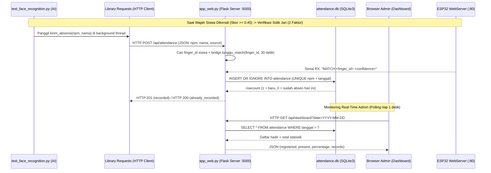
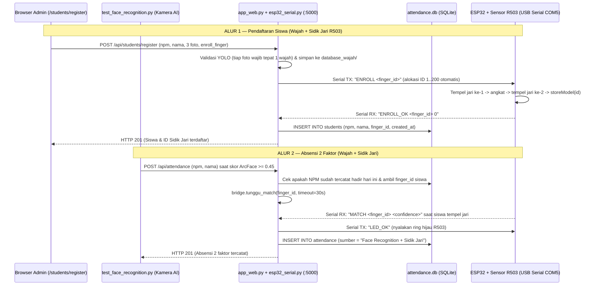

# Cara Kerja Website Flask, Database SQLite, Requests, dan IoT ESP32

Dokumen ini membahas khusus bagian **Backend Web Server (Flask)**, **Database Lokal (SQLite)**, **Komunikasi HTTP (`requests`)**, dan **Firmware Mikrokontroler (Arduino ESP32)**.

> Untuk bagian AI, Deteksi Wajah (YOLO), dan Pengenalan Wajah (InsightFace), lihat dokumen terpisah: **[`CARA_KERJA_YOLO_DAN_FACE_RECOGNITION.md`](CARA_KERJA_YOLO_DAN_FACE_RECOGNITION.md)**.

---

## 1. Arsitektur Komunikasi Web, Database & IoT



---

## 2. Daftar Library Bagian Website, Database & IoT

| Library | Peran dalam Sistem Web, Database & IoT | Website Resmi |
| :--- | :--- | :--- |
| **Flask** | Backend web server lokal (`127.0.0.1:5000`), penyedia REST API absensi, halaman dashboard, dan pendaftaran siswa. | [https://flask.palletsprojects.com](https://flask.palletsprojects.com) |
| **Requests** | HTTP client pada Python untuk mengirim data JSON presensi 2 faktor ke Flask (`POST`). Verifikasi sidik jari ditangani server lewat USB Serial, bukan HTTP ke ESP32. | [https://requests.readthedocs.io](https://requests.readthedocs.io) |
| **SQLite (`sqlite3`)** | Mesin database relasional berbasis file tunggal (`attendance.db`) untuk menyimpan histori kehadiran harian. | [https://www.sqlite.org](https://www.sqlite.org) |
| **Arduino ESP32** | SDK mikrokontroler (`WiFi.h` & `WebServer.h`) untuk menerima sinyal absensi melalui jaringan Wi-Fi lokal. | [https://espressif.github.io/arduino-esp32/](https://espressif.github.io/arduino-esp32/) |

---

## 3. Penjelasan Mendalam Tiap Library & Bedah Kode

### 1. Flask (`flask`)
* **Fungsi di Proyek**: Menjalankan server web lokal di alamat `http://127.0.0.1:5000` yang menghubungkan antarmuka browser admin (`index.html`, `enroll.html`), penyimpanan foto wajah (`database_wajah/`), dan database SQLite (`attendance.db`).
* **Cara Kerja & Endpoint di `app_web.py`**:
  1. `GET /` (`dashboard`): Merender halaman HTML utama monitoring absensi.
  2. `GET /students/register` (`student_registration_page`): Merender halaman pendaftaran wajah siswa via webcam browser.
  3. `POST /api/students/register` (`register_student`): Menerima input NPM, nama, dan 3 foto Base64 dari browser, memvalidasi tepat 1 wajah per foto, lalu menyimpan ke `database_wajah/NPM_Nama/foto1..3.jpg`.
  4. `GET /api/dashboard` (`dashboard_data`): Mengirimkan data JSON berisi jumlah siswa terdaftar, total hadir hari ini, persentase kehadiran, dan tabel riwayat absensi. Diambil otomatis oleh `static/app.js` setiap 1 detik.
  5. `POST /api/attendance` (`add_attendance`): Menerima laporan wajah dikenali dari script AI dan menyimpannya ke SQLite.
  6. `GET /api/export` (`export_csv`): Mengunduh rekap kehadiran tanggal tertentu dalam format `.csv` (kompatibel langsung dengan Microsoft Excel).
* **Potongan Kode Inti (`app_web.py:261-300`)**:
  ```python
  @app.post("/api/attendance")
  def add_attendance():
      payload = request.get_json(silent=True) or {}
      npm = str(payload.get("npm", "")).strip()
      nama = str(payload.get("nama", "")).strip()
      ...
      with get_db() as connection:
          cursor = connection.execute(
              """
              INSERT OR IGNORE INTO attendance (npm, nama, tanggal, waktu, status, sumber)
              VALUES (?, ?, ?, ?, 'Hadir', ?)
              """,
              (npm, nama, today, now_time, source),
          )
          connection.commit()
  ```
* **Link Gambar & Dokumentasi**:
  * Gambar Logo & Dokumentasi Flask: [https://raw.githubusercontent.com/pallets/flask/refs/heads/stable/docs/_static/flask-name.svg](https://raw.githubusercontent.com/pallets/flask/refs/heads/stable/docs/_static/flask-name.svg)
  * Website Resmi: [https://flask.palletsprojects.com](https://flask.palletsprojects.com)
  

---

### 2. Requests (`requests`)
* **Fungsi di Proyek**: Penghubung komunikasi jaringan (*HTTP Client*) dari program AI (`test_face_recognition.py`) ke server Flask lokal yang memegang port USB ESP32/R503.
* **Cara Kerja (`test_face_recognition.py:230-263`)**:
  Saat wajah siswa dikenali dengan skor kemiripan $\ge 0.45$, fungsi `kirim_absensi(npm, nama)` dijalankan pada *background thread* (`ThreadPoolExecutor`) agar video kamera tidak macet (*freeze*) sambil menunggu jari ditempel:
  1. **Langkah 1 — Minta Verifikasi 2 Faktor (`requests.post`)**: Mengirimkan paket JSON `{"npm": npm, "nama": nama, "source": "Face Recognition"}` ke `http://127.0.0.1:5000/api/attendance` dengan batas waktu 35 detik (server menunggu sidik jari maksimal 30 detik).
  2. **Langkah 2 — Respons Server**: Jika sidik jari cocok, Flask membalas HTTP `201` dengan `finger_confidence`; jika jari tidak cocok / waktu habis, Flask membalas HTTP `401` dan absensi **tidak** dicatat.
  3. **Fault Tolerance (Tahan Gagal)**: Respons non-2xx (`401`, `409`, `503`) diubah menjadi `RuntimeError` berisi pesan dari server, lalu dicoba ulang oleh loop utama setiap 5 detik selama wajah masih terdeteksi.
* **Potongan Kode Inti (`test_face_recognition.py:234-263`)**:
  ```python
  print("Menunggu verifikasi sidik jari R503 (30 detik)... Tempelkan jari pada sensor.")

  web_response = requests.post(
      DASHBOARD_API_URL,
      json={"npm": npm, "nama": nama, "source": "Face Recognition"},
      timeout=35,
  )

  data_web = web_response.json() if web_response.content else {}
  if not web_response.ok:
      raise RuntimeError(
          data_web.get("message")
          or f"Absensi 2 faktor ditolak (HTTP {web_response.status_code})."
      )
  ```
* **Link Gambar & Dokumentasi**:
  * Badge & Dokumentasi Resmi Requests: [https://requests.readthedocs.io](https://requests.readthedocs.io)
  * Repository GitHub: [https://github.com/psf/requests](https://github.com/psf/requests)
  

---

### 3. SQLite (`sqlite3`)
* **Fungsi di Proyek**: Menyimpan seluruh data kehadiran secara permanen di dalam file lokal `attendance.db` tanpa memerlukan instalasi database server berat seperti MySQL atau PostgreSQL.
* **Cara Kerja & Skema Tabel (`app_web.py:28-52`)**:
  1. Menggunakan pustaka bawaan Python `sqlite3` dengan `sqlite3.Row` sehingga setiap baris hasil query dapat diakses layaknya *dictionary* (`row["npm"]`, `row["nama"]`).
  2. Tabel `attendance` memiliki aturan kunci unik **`UNIQUE(npm, tanggal)`**.
  3. Dikombinasikan dengan perintah SQL **`INSERT OR IGNORE`**, database secara otomatis menolak pencatatan ganda jika siswa yang sama berdiri di depan kamera berkali-kali pada hari yang sama (1 NPM = maksimal 1 absensi per tanggal kalender).
  4. Tabel `students (npm PRIMARY KEY, nama, finger_id UNIQUE, created_at)` menyimpan pemetaan NPM ke nomor slot template sidik jari R503 (`1–200`).
* **Skema Tabel (`app_web.py:38-47`)**:
  ```sql
  CREATE TABLE IF NOT EXISTS attendance (
      id INTEGER PRIMARY KEY AUTOINCREMENT,
      npm TEXT NOT NULL,
      nama TEXT NOT NULL,
      tanggal TEXT NOT NULL,
      waktu TEXT NOT NULL,
      status TEXT NOT NULL DEFAULT 'Hadir',
      sumber TEXT NOT NULL DEFAULT 'Face Recognition',
      UNIQUE(npm, tanggal)
  );
  ```
* **Link Gambar & Dokumentasi**:
  * Gambar Logo Resmi SQLite: [https://www.sqlite.org/images/sqlite370.gif](https://www.sqlite.org/images/sqlite370.gif)
  * Website Resmi: [https://www.sqlite.org](https://www.sqlite.org) / [Python sqlite3 Docs](https://docs.python.org/3/library/sqlite3.html)
  

---

### 4. Arduino ESP32 + R503 (`Adafruit_Fingerprint.h`, `HardwareSerial`)
* **Fungsi di Proyek**: Merekam template sidik jari siswa (slot `1..200`) dan memverifikasi kecocokan jari saat absensi. Komunikasi ke laptop memakai **kabel USB (Serial 115200 baud)**, bukan Wi-Fi.
* **Cara Kerja (`firmware/esp32R503-Serial/esp32R503-Serial.ino`)**:
  1. `Serial.begin(115200)` menjadi kanal perintah/event ke `app_web.py`; `fpSerial.begin(57600, SERIAL_8N1, 16, 17)` menjadi kanal UART ke sensor R503.
  2. `prosesPerintah()` menerima baris perintah `PING`, `ENROLL <id>`, `DELETE <id>`, `CLEAR`, dan `LED_OK`.
  3. `enrollFinger(id)` meminta jari ditempel dua kali (`PLACE` → `REMOVE` → `PLACE`), memanggil `createModel()` lalu `storeModel(id)`, dan membalas `ENROLL_OK <id> 0`.
  4. `verifikasi()` dipanggil terus di `loop()`; saat ada jari cocok ia mengirim `MATCH <id> <confidence>` ke laptop, lalu `tungguJariAngkat()` mencegah satu tempelan memicu event berulang.
  5. **Catatan**: sketch lama `ESP32_Smart_Attendance.ino` (Wi-Fi `WebServer`) tetap ada sebagai referensi indikator jarak jauh, tetapi alur absensi terbaru tidak lagi memanggilnya.
* **Potongan Kode Inti (`esp32R503-Serial.ino`)**:
  ```cpp
  void verifikasi() {
    uint8_t p = finger.getImage();
    if (p != FINGERPRINT_OK) return;
    p = finger.image2Tz();
    if (p != FINGERPRINT_OK) return;
    p = finger.fingerSearch();
    if (p == FINGERPRINT_OK) {
      char buffer[48];
      snprintf(buffer, sizeof(buffer), "MATCH %u %u", finger.fingerID, finger.confidence);
      kirim(buffer);
    }
  }
  ```
* **Link Gambar & Dokumentasi**:
  * Diagram Pinout & Dokumentasi Resmi ESP32: [https://docs.espressif.com/projects/arduino-esp32/en/latest/_images/esp32-devkitC-v4-pinout.png](https://docs.espressif.com/projects/arduino-esp32/en/latest/_images/esp32-devkitC-v4-pinout.png)
  * Dokumentasi Arduino-ESP32: [https://espressif.github.io/arduino-esp32/](https://espressif.github.io/arduino-esp32/)
  

### C. Tabel Ringkasan Endpoint Terkini

| Method | Endpoint | Fungsi |
| :--- | :--- | :--- |
| `GET` | `/` | Dashboard admin (termasuk menu **Siswa Terdaftar**). |
| `GET` | `/students/register` | Form pendaftaran 3 foto wajah + opsi rekam sidik jari R503. |
| `POST` | `/api/students/register` | Validasi YOLO, simpan foto, opsional rekam sidik jari (`enroll_finger: true`). |
| `GET` | `/api/students` | Daftar siswa terdaftar (`nama`, `npm`, `photo_count`, `finger_id`, `created_at`), terbaru di atas. |
| `GET` | `/api/fingerprint/status` | Status koneksi ESP32 (`connected`, `port`), jumlah template, dan `next_finger_id`. |
| `POST` | `/api/fingerprint/enroll` | Rekam sidik jari susulan untuk NPM yang sudah punya foto wajah. |
| `POST` | `/api/attendance` | Gate 2FA: wajah + `MATCH` sidik jari, lalu `INSERT` ke `attendance`. |
| `GET` | `/api/dashboard` | Statistik + riwayat absensi + daftar `students` (polling `static/app.js` tiap 1 detik). |
| `GET` | `/api/export` | Unduh CSV absensi per tanggal. |
| `GET` | `/health` | Health check server. |

---

## 4. Integrasi Sensor Sidik Jari R503 (USB Serial) & Verifikasi 2 Faktor (2FA)

### A. Alur Kerja (Flow) Pendaftaran & Absensi 2 Faktor



### B. Penjelasan File & Fungsi Kode Baru

1. **`firmware/esp32R503-Serial/esp32R503-Serial.ino` (Firmware ESP32 + R503)**:
   * Menggunakan `HardwareSerial fpSerial(2)` di pin `RX=16`, `TX=17` (`57600` baud) ke sensor R503, dan `Serial` (`115200` baud) melalui kabel USB ke laptop.
   * `loop()` terus membaca sensor lewat `verifikasi()`: saat jari ditempel dan cocok dengan template di memori R503, ESP32 mengirim baris `MATCH <id> <confidence>` ke laptop.
   * `prosesPerintah()` menangani perintah dari Flask: `PING` (`PONG <jumlah>`), `ENROLL <id>` (rekam 2x tempel jari lalu balas `ENROLL_OK <id> 0`), `DELETE <id>`, `CLEAR`, dan `LED_OK`.

2. **`esp32_serial.py` (Jembatan USB Serial Tunggal)**:
   * Karena 1 port `COM` di Windows hanya boleh dibuka oleh **1 program** dalam satu waktu, hanya `app_web.py` yang membuka `COM5` melalui objek singleton `bridge = R503Bridge()`.
   * `pilih_port()`: Mendeteksi otomatis port USB ESP32 berdasarkan USB Vendor ID (`CP210x`, `CH340`, `ESP32`) atau variabel `ESP32_PORT`.
   * `_loop_baca()`: Thread background yang terus membaca setiap baris dari `COM5`. Jika menerima `MATCH <id> <conf>`, data dimasukkan ke antrean `self._match`.
   * `enroll(finger_id)`: Mengirim `ENROLL <id>\n` ke ESP32 dan menunggu balasan `ENROLL_OK <id>` (batas waktu 45 detik).
   * `tunggu_match(finger_id, timeout=30)`: Menunggu di antrean sampai sensor R503 mengirimkan `MATCH` dengan ID jari yang **sama persis** dengan `finger_id` milik siswa yang wajahnya baru dikenali kamera.
   * `tunggu_match()` **gagal cepat**: `NOMATCH` atau `MATCH` dengan ID siswa lain langsung mengembalikan `(None, alasan)` tanpa menunggu 30 detik, dan event lama di antrean dibuang lebih dulu agar satu tempelan tidak bisa memverifikasi dua permintaan.
   * **Satu port = satu program**: jika `COM5` sudah dipegang Serial Monitor Arduino IDE atau instance `app_web.py` lain, error `PermissionError` dilaporkan sebagai pesan ramah dan koneksi diulang tiap 2 detik. `app_web.py` menolak start kedua di port `5000` supaya tidak ada dua proses yang berebut sensor.

3. **`app_web.py` (Database Siswa, Endpoint Sidik Jari & Gate 2FA)**:
   * Tabel baru `students (npm PRIMARY KEY, nama, finger_id UNIQUE, created_at)` menyimpan pasangan NPM dan nomor slot sidik jari (`1–200`) di sensor R503.
   * `next_finger_id()`: Mencari nomor slot terkecil (`1..200`) yang belum dipakai siswa lain.
   * `list_registered_students()` & `GET /api/students`: Menggabungkan data folder `database_wajah/` dan tabel `students` untuk ditampilkan pada menu **Siswa Terdaftar**.
   * `POST /api/attendance`: Memeriksa apakah siswa sudah punya `finger_id`, lalu memanggil `bridge.tunggu_match(finger_id, timeout=30)` sebelum melakukan `INSERT` ke tabel `attendance`.

4. **`test_face_recognition.py` (Pemicu Absensi 2 Faktor)**:
   * Fungsi `kirim_absensi(npm, nama)` dijalankan di background thread (`http_executor`) saat wajah siswa terverifikasi, sehingga tampilan video kamera tidak macet sambil menunggu siswa menempelkan jari di R503.
   * Selama menunggu jari ditempel, layar kamera menampilkan instruksi `TEMPELKAN JARI DI R503: <NPM>`.
   * Jika sidik jari ditolak, percobaan diulang dengan backoff `15 → 30 → 60` detik (`jeda_ulang()`), bukan setiap 30 detik tanpa henti. Layar menampilkan hitung mundur; menjauhkan wajah > 5 detik mereset backoff.
