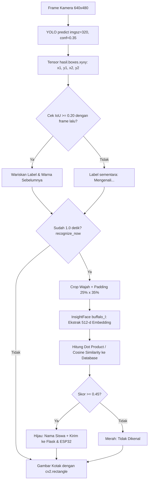

# Cara Kerja Model YOLO, Bounding Box, dan Face Recognition pada Proyek Ini

Dokumen ini menjelaskan alur teknis bagaimana gambar dari kamera diubah menjadi **kotak deteksi wajah (bounding box)** oleh **YOLO** hingga dikenali identitasnya oleh **InsightFace (ArcFace)**, mulai dari teori model hingga baris kode Python di proyek ini.

---

## 1. Perbedaan Peran: YOLO vs InsightFace

Banyak yang mengira YOLO langsung mengenali nama siswa. Pada proyek ini, tugas dibagi menjadi **2 tahap (Two-Stage Pipeline)**:

| Tahap | Model yang Dipakai | Tugas Utama | Output |
| :--- | :--- | :--- | :--- |
| **1. Face Detection** | **YOLO** (`yolo26n-face.pt`) | Mencari **di mana** posisi wajah di dalam gambar/frame kamera. | Koordinat kotak wajah (**Bounding Box** `x1, y1, x2, y2`) + skor keyakinan (`confidence`). |
| **2. Face Recognition** | **InsightFace** (`buffalo_l` / ArcFace) | Mengenali **siapa** pemilik wajah di dalam kotak tersebut. | Vektor fitur 512 angka (**Embedding**) yang dicocokkan dengan foto di `database_wajah/`. |

---

## 2. Bagaimana YOLO Membuat Bounding Box? (Teori & Artikel Referensi)

Berdasarkan dokumentasi resmi [Ultralytics YOLO](https://docs.ultralytics.com/tasks/detect/) dan panduan [YOLO26 End-to-End NMS-Free Detection](https://docs.ultralytics.com/guides/end2end-detection/), berikut tahapan internal YOLO saat memproses satu gambar:

### A. Resize & Letterbox (`imgsz=320`)
Sebelum masuk ke jaringan saraf tiruan (Convolutional Neural Network), frame kamera berukuran `640x480` diperkecil (*resize*) menjadi ukuran input model yaitu `320x320` piksel (`imgsz=320`) agar komputasi di CPU cepat.

### B. Pembagian Grid & Prediksi Kandidat Kotak
YOLO (*You Only Look Once*) membagi gambar menjadi grid fitur multi-skala. Pada setiap titik grid, kepala deteksi (*detection head*) memprediksi:
1. **Koordinat kotak**: Titik tengah `(cx, cy)`, lebar `w`, dan tinggi `h` (atau jarak ke keempat sisi kotak).
2. **Confidence Score (`conf`)**: Peluang `0.0 – 1.0` bahwa di dalam kotak tersebut benar-benar terdapat objek kelas `wajah`.

### C. Penyaringan Ambang Batas (`conf=0.35`) & Penanganan Kotak Tumpang Tindih
* Semua kandidat kotak dengan skor keyakinan di bawah `0.35` (`YOLO_CONFIDENCE = 0.35`) langsung dibuang.
* Pada model YOLO standar (YOLOv8/v11), algoritma **NMS (Non-Maximum Suppression)** menghapus kotak-kotak yang bertumpuk pada wajah yang sama dan hanya menyisakan 1 kotak dengan skor tertinggi. Pada arsitektur **YOLO26**, kepala deteksi *one-to-one* menghasilkan prediksi langsung tanpa NMS (*end-to-end NMS-free*).

### D. Rescaling ke Ukuran Frame Asli (`xyxy`)
Koordinat kotak dari skala `320x320` dikembalikan (*rescale*) ke ukuran piksel gambar asli (`640x480`) dalam format **`xyxy`**:
* `(x1, y1)` = Titik sudut **kiri atas** kotak wajah.
* `(x2, y2)` = Titik sudut **kanan bawah** kotak wajah.

```text
(0,0) Frame Kamera (640 x 480)
  +-----------------------------------------+
  |                                         |
  |       (x1, y1)                          |
  |          +---------------+              |
  |          |               |              |
  |          |  WAJAH SISWA  | tinggi       |
  |          |               | (y2 - y1)    |
  |          +---------------+              |
  |                 lebar    (x2, y2)       |
  |               (x2 - x1)                 |
  +-----------------------------------------+
```

---

## 3. Alur Kode Python di Proyek Ini

### A. Pemakaian YOLO Saat Pendaftaran Siswa (`app_web.py`)
Saat admin mengambil 3 foto di halaman web pendaftaran, fungsi `decode_and_validate_photo()` di `app_web.py` memanggil YOLO untuk memastikan setiap foto valid:

```python
# app_web.py (baris 118-132)
result = detector.predict(
    source=image,       # Gambar hasil decode dari kamera browser
    conf=0.35,          # Minimal keyakinan 35% bahwa itu wajah
    imgsz=320,          # Ukuran pemrosesan internal YOLO 320x320
    device="cpu",       # Dijalankan di prosesor laptop (CPU)
    verbose=False,
)[0]

# Menghitung jumlah bounding box wajah yang ditemukan
face_count = len(result.boxes) if result.boxes is not None else 0
if face_count != 1:
    # Ditolak jika 0 wajah (kosong/blur) atau >1 wajah (ada orang lain bocor di kamera)
    raise ValueError(...)
```
Di sini, koordinat kotak tidak digambar ke layar; `app_web.py` hanya mengecek `len(result.boxes) == 1` sebagai gerbang validasi kualitas data.

---

### B. Pemakaian YOLO + Bounding Box Real-Time (`test_face_recognition.py`)

Di `test_face_recognition.py`, proses deteksi dan penggambaran kotak dilakukan secara terus-menerus pada video webcam melalui 5 langkah:

#### Langkah 1: Deteksi Kotak Wajah dengan YOLO
Di dalam `FaceProcessor.process()`:
```python
# test_face_recognition.py (baris 282-304)
hasil = self.yolo.predict(
    source=frame,
    conf=YOLO_CONFIDENCE,   # 0.35
    imgsz=YOLO_IMAGE_SIZE,  # 320
    device="cpu",
    verbose=False
)[0]

detections = []
if hasil.boxes is not None:
    # Mengambil tensor koordinat [x1, y1, x2, y2], pindah ke numpy integer
    boxes = hasil.boxes.xyxy.cpu().numpy().astype(int)
    for box in boxes:
        detections.append(tuple(map(int, box)))  # Contoh: (210, 120, 380, 340)
```
* `hasil.boxes.xyxy` adalah objek dari Ultralytics yang menyimpan matriks berukuran `(N, 4)`, di mana `N` adalah jumlah wajah di kamera dan `4` adalah `[x1, y1, x2, y2]`.

#### Langkah 2: Tracking Kotak Antar-Frame dengan IoU (`hitung_iou`)
Pengenalan wajah (InsightFace) itu berat jika dijalankan 30 kali per detik. Karena itu, proyek ini hanya menjalankan InsightFace setiap **1 detik sekali** (`RECOGNITION_INTERVAL = 1.0`).
Di sela-sela 1 detik tersebut, bagaimana agar nama siswa tetap menempel di kotak wajah saat kepalanya bergerak sedikit? Jawabannya adalah **IoU (Intersection over Union)** di baris 172–202:

$$\text{IoU} = \frac{\text{Luas Irisan Dua Kotak}}{\text{Luas Gabungan Dua Kotak}}$$

* Jika kotak wajah pada frame sekarang beririsan dengan kotak pada frame sebelumnya sebesar $\ge 20\%$ (`IOU_THRESHOLD = 0.20`), maka sistem menyalin label nama & warna dari kotak sebelumnya tanpa perlu menjalankan ulang InsightFace.

#### Langkah 3: Cropping (Memotong) Area Wajah + Padding dengan OpenCV
Di dalam OpenCV, satu frame video adalah matriks angka 3 dimensi `(480 baris Y × 640 kolom X × 3 warna BGR)`. Saat waktunya mengenali identitas (`recognize_now == True`), kode memotong (*crop*) gambar wajah berdasarkan koordinat bounding box YOLO, ditambah margin (*padding*) **25% kiri-kanan (`pad_x`)** dan **35% atas-bawah (`pad_y`)** agar dahi, rambut, telinga, dan rahang ikut masuk (karena kotak asli YOLO terlalu mepet alis/dagu untuk pelurusan wajah InsightFace):

```text
(0,0) X ───────────────────────────► Lebar Frame (640)
  │
  │      (cx1, cy1)  [Kotak Crop + Padding OpenCV]
  │         + - - - - - - - - - - - - - - - - +  ▲
  │         |           pad_y (+35%)          |  │
  │         |     (x1,y1) [Kotak Ketat YOLO]  |  │
  │         |        +-----------------+      |  │ Tinggi Potongan
  │         |  pad_x |   WAJAH SISWA   |pad_x |  │ (cy1:cy2)
  │         | (+25%) | (Alis s.d Dagu) |(+25%)|  │
  │         |        +-----------------+      |  │
  │         |                 (x2,y2)         |  │
  │         + - - - - - - - - - - - - - - - - +  ▼
  ▼         ◄────── Lebar Potongan (cx1:cx2) ─► (cx2, cy2)
Tinggi Frame (480)
```

```python
# test_face_recognition.py (baris 360-373)
x1, y1, x2, y2 = bbox
lebar = x2 - x1
tinggi = y2 - y1

pad_x = int(lebar * 0.25)
pad_y = int(tinggi * 0.35)

cx1 = max(0, x1 - pad_x)
cy1 = max(0, y1 - pad_y)
cx2 = min(lebar_frame, x2 + pad_x)
cy2 = min(tinggi_frame, y2 + pad_y)

crop = frame[cy1:cy2, cx1:cx2]  # Potongan array NumPy khusus area wajah
```

> **Catatan Penting OpenCV**:
> * Saat memotong matriks (`crop = frame[cy1:cy2, cx1:cx2]`), urutannya wajib **`[Baris_Y, Kolom_X]`** (Tinggi `cy` dulu, baru Lebar `cx`).
> * Saat menggambar kotak (`cv2.rectangle(frame, (x1, y1), (x2, y2))`), urutannya adalah **`(Kolom_X, Baris_Y)`** (`x` dulu, baru `y`).
> * Urutan warna di OpenCV adalah **B-G-R (Biru, Hijau, Merah)**, bukan RGB: `(0, 200, 0)` = Hijau, `(0, 0, 255)` = Merah, `(0, 165, 255)` = Oranye.

#### Langkah 4: Ekstraksi Embedding & Pencocokan Cosine Similarity (`kenali_siswa`)
Potongan gambar `crop` dikirim ke **InsightFace (`self.face_app.get(crop)`)**:
1. InsightFace menghasilkan `normed_embedding` (vektor 512 angka yang sudah dinormalisasi panjangnya menjadi 1).
2. Fungsi `kenali_siswa()` menghitung kemiripan sudut (**Cosine Similarity**) antara vektor wajah di kamera dengan vektor rata-rata tiap siswa di `database_wajah/` menggunakan perkalian titik (*dot product* `np.dot`):

$$\text{Skor Kemiripan} = \mathbf{E}_{\text{kamera}} \cdot \mathbf{E}_{\text{database}}$$

3. Jika skor tertinggi $\ge 0.45$ (`FACE_THRESHOLD = 0.45`), wajah dinyatakan cocok:
   * Warna kotak diset **Hijau** `(0, 200, 0)` dengan teks `"Nama Siswa | skor 0.xx"`.
   * Jika $< 0.45$, warna kotak diset **Merah** `(0, 0, 255)` dengan teks `"Tidak dikenal"`.

#### Langkah 5: Menggambar Bounding Box ke Layar (`cv2.rectangle`)
Hasil koordinat `bbox` dan `color` akhirnya digambar ke frame video oleh OpenCV di loop utama:

```python
# test_face_recognition.py (baris 617-637)
for track in tracks_terakhir:
    x1, y1, x2, y2 = track["bbox"]

    # Menggambar kotak persegi panjang di sekeliling wajah
    cv2.rectangle(
        frame,
        (x1, y1),          # Titik kiri atas
        (x2, y2),          # Titik kanan bawah
        track["color"],    # Hijau (dikenal), Merah (asing), Oranye (memproses)
        2                  # Ketebalan garis 2 piksel
    )

    # Menulis teks nama & skor tepat di atas garis atas kotak (y1 - 10)
    cv2.putText(
        frame,
        track["label"],
        (x1, max(25, y1 - 10)),
        cv2.FONT_HERSHEY_SIMPLEX,
        0.55,
        track["color"],
        2
    )
```

---

## 4. Ringkasan Alur Data End-to-End



---

## 5. Referensi Artikel & Dokumentasi Resmi
1. **Ultralytics YOLO Object Detection Docs** — Penjelasan cara kerja deteksi objek dan format output kotak: [https://docs.ultralytics.com/tasks/detect/](https://docs.ultralytics.com/tasks/detect/)
2. **Ultralytics Predict Mode & `Boxes` Class Reference** — Struktur properti `result.boxes.xyxy`, `conf`, dan parameter `imgsz`: [https://docs.ultralytics.com/modes/predict/](https://docs.ultralytics.com/modes/predict/) & [https://docs.ultralytics.com/reference/engine/results/](https://docs.ultralytics.com/reference/engine/results/)
3. **Ultralytics YOLO26 End-to-End Detection** — Arsitektur model `yolo26` dan prediksi bounding box `xyxy`: [https://docs.ultralytics.com/guides/end2end-detection/](https://docs.ultralytics.com/guides/end2end-detection/)
4. **InsightFace (DeepInsight) Repository** — Pustaka analisis wajah 2D/3D dan ekstraksi fitur ArcFace (`buffalo_l`): [https://github.com/deepinsight/insightface](https://github.com/deepinsight/insightface)

---

## 6. Daftar Library AI & Face Recognition

| Library | Peran dalam Pipeline AI & Vision | Website Resmi |
| :--- | :--- | :--- |
| **Ultralytics YOLO** | Deteksi lokasi wajah (*bounding box* `xyxy`) pada frame kamera. | [https://www.ultralytics.com](https://www.ultralytics.com) / [Docs](https://docs.ultralytics.com) |
| **InsightFace** | Ekstraksi fitur biometrik wajah 512-dimensi (*ArcFace* `buffalo_l`). | [https://insightface.ai](https://insightface.ai) / [GitHub](https://github.com/deepinsight/insightface) |
| **OpenCV (`cv2`)** | Akuisisi kamera, *cropping* wajah, dan penggambaran `cv2.rectangle()` / `cv2.putText()`. | [https://opencv.org](https://opencv.org) / [Docs](https://docs.opencv.org) |
| **NumPy** | Komputasi matriks gambar, normalisasi L2 (`np.linalg.norm`), dan *Cosine Similarity* (`np.dot`). | [https://numpy.org](https://numpy.org) |
| **ONNX Runtime** | Runtime eksekusi model `.onnx` milik InsightFace di CPU (`CPUExecutionProvider`). | [https://onnxruntime.ai](https://onnxruntime.ai) |
| **PyTorch (`torch`)** | Engine deep learning di balik model `.pt` milik Ultralytics YOLO. | [https://pytorch.org](https://pytorch.org) |

> Penjelasan lengkap per pustaka beserta konsep **ArcFace**, analogi, ilustrasi, dan potongan baris kode asli proyek telah dipisahkan ke dokumen khusus: **[`PENJELASAN_6_LIBRARY_AI_VISION.md`](PENJELASAN_6_LIBRARY_AI_VISION.md)**.
